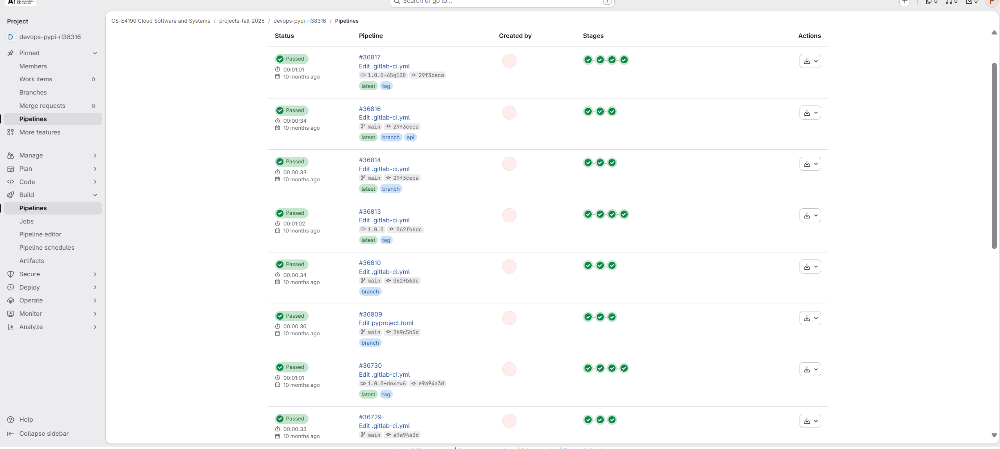
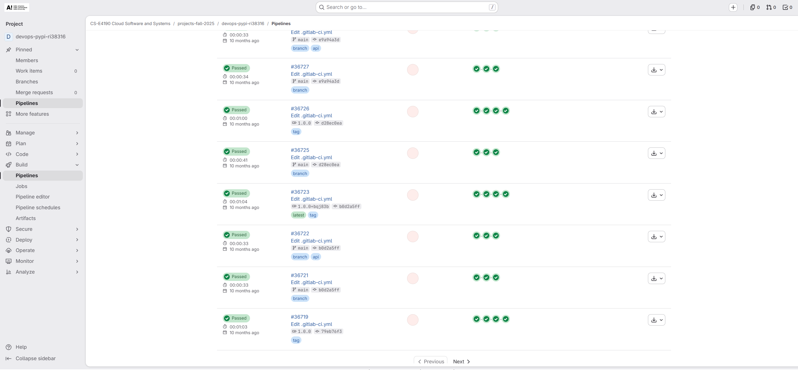
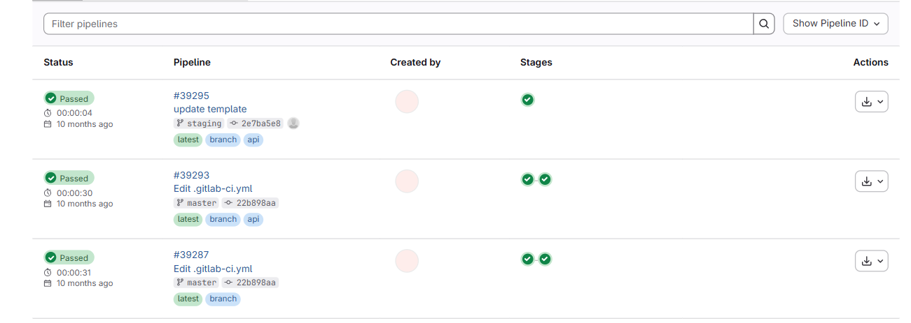

# Automated CI/CD Pipeline & DevOps (GitLab CI & GCP)

GitLab CI/CD pipelines that take a small Python package and its documentation site from a commit
to Google Cloud. The package, `tempconv`, is linted with Pylint, tested with Pytest, versioned from
its Git tag and published to Google Artifact Registry. Its MkDocs site is deployed to two
environments: production, a static site in Cloud Storage built from `master`, and staging, an Nginx
container on Cloud Run built from `staging`.

The work comes from the DevOps assignments of CS-E4190 Cloud Software and Systems at Aalto
University (fall 2025), where the package and the site were two GitLab projects. They are kept
here as two folders of one repository, each with the `.gitlab-ci.yml` it ran with:

| Folder | What it is | Pipeline |
|---|---|---|
| `python-package/` | the `tempconv` package and its tests | lint, test, build, then publish to Artifact Registry |
| `docs-site/` | the MkDocs site, its Dockerfile and Nginx config | build, then deploy to Cloud Storage or Cloud Run |

## Package pipeline

`python-package/.gitlab-ci.yml` runs four stages. Each starts only when the one before it passes.

| Stage | Does | Runs on |
|---|---|---|
| `lint` | Pylint on `src/` and `tests/` | every pipeline |
| `test` | Pytest with coverage; the JUnit and Cobertura reports show up in GitLab's pipeline and merge request views | every pipeline |
| `build` | on a tag, checks that it is `x.y.z` or `x.y.z+local` and writes it into `pyproject.toml`; then builds the sdist and wheel | every pipeline |
| `publish` | uploads `dist/*` to Artifact Registry with Twine, authenticated by a service account key | tags only |

A release is one tag:

```bash
git tag 1.2.3
git push origin 1.2.3
```

`v1.2.3` or `1.2` fails `build`, and nothing is published. A push without a tag still lints, tests
and builds, as version `0.0.0`.

To install a published version:

```bash
pip install keyrings.google-artifactregistry-auth
gcloud auth application-default login
pip install --index-url https://<GAR_LOCATION>-python.pkg.dev/<GCP_PROJECT_ID>/<GAR_REPOSITORY>/simple/ tempconv
```

## Documentation site pipeline

`docs-site/.gitlab-ci.yml` chooses the environment from the branch:

| Branch | Environment | Jobs | Ends up |
|---|---|---|---|
| `master` | `production` | `mkdocs build --strict`, then `gsutil rsync` of the site to a bucket | `https://storage.googleapis.com/<GCS_BUCKET>/index.html` |
| `staging` | `staging` | `docker build`, push to Artifact Registry tagged with the commit SHA, `gcloud run deploy` | the Cloud Run service `mkdocs-staging`, whose URL is passed back to the GitLab environment |

The image is built in two stages. `python:3.11-slim` installs MkDocs and builds the site, and
`nginx:stable-alpine` copies only the built site and serves it on port 8080, the port Cloud Run
sends traffic to. The site itself documents `tempconv`: installation, the API and the release
process.

## CI/CD variables

Set under Settings > CI/CD > Variables in each GitLab project. Every job that needs one checks it
first and stops with the name of any that is missing.

| Variable | Project | Value |
|---|---|---|
| `GCP_CREDENTIALS` | both | service account JSON key, as a Variable or a File. The package needs Artifact Registry Writer; the site needs Storage Object Admin, plus Artifact Registry Writer, Cloud Run Admin and Service Account User for staging. Mark it Masked and Protected, and protect release tags so tag pipelines receive it |
| `GCP_PROJECT_ID` | both | Google Cloud project ID |
| `GAR_LOCATION` | package | Artifact Registry region, e.g. `europe-north1` |
| `GAR_REPOSITORY` | package | Python repository name, e.g. `tempconv-repo` |
| `GCS_BUCKET` | site | bucket name without `gs://`; it needs public read access to serve the site |
| `GCP_REGION` | site | region for Cloud Run, e.g. `europe-north1` |
| `REPOSITORY_PATH` | site | Docker repository, e.g. `europe-north1-docker.pkg.dev/<project-id>/<repository>` |

## Running locally

Tested with Python 3.10 to 3.13.

```bash
cd python-package
pip install pylint pytest pytest-cov .
pylint src/ tests/                       # the lint stage
pytest --cov=tempconv                    # the test stage
python -m build                          # the build stage; needs `pip install build`

cd ../docs-site
pip install -r requirements.txt
mkdocs serve                             # preview at http://localhost:8000
docker build -t mkdocs-site .            # the staging image
docker run --rm -p 8080:8080 mkdocs-site # serve it at http://localhost:8080
```

## GitHub Actions

GitHub does not run `.gitlab-ci.yml`. On every push, two workflows run the checks that need no
cloud account:

- `python-package.yml`: Pylint, then Pytest with coverage on Python 3.10, 3.11, 3.12 and 3.13
- `docs-site.yml`: `mkdocs build --strict`, then `docker build`, then starts the container and
  checks that it serves the site

## Pipeline runs on GitLab

Tag pipelines of the package ran all four stages, `publish` included:




Pipelines on `master` of the site ran `build` and the deploy to Cloud Storage:



## Project layout

```
README.md                       this file
python-package/
  src/tempconv/converter.py     Celsius, Fahrenheit and Kelvin conversions
  tests/test_converter.py       Pytest tests
  pyproject.toml                package metadata; build writes the version here
  README.md                     the package description shown in Artifact Registry
  .gitlab-ci.yml                lint, test, build, publish
docs-site/
  docs/                         the site's pages
  mkdocs.yml                    site configuration, Material theme
  Dockerfile                    MkDocs build stage, then Nginx
  nginx.conf                    serves the site on port 8080
  requirements.txt              MkDocs and the Material theme
  .gitlab-ci.yml                build and deploy, production and staging
.github/workflows/              the GitHub Actions above
screenshots/                    the GitLab pipeline runs
```

## License

[MIT](LICENSE)
